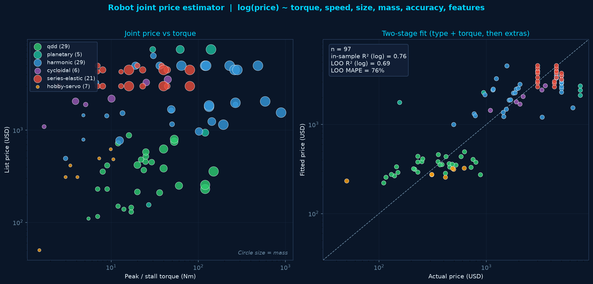
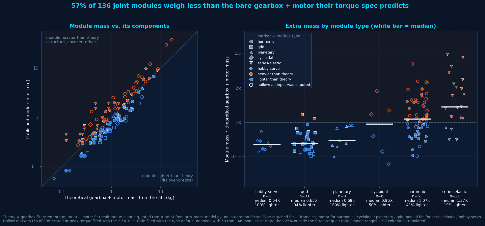
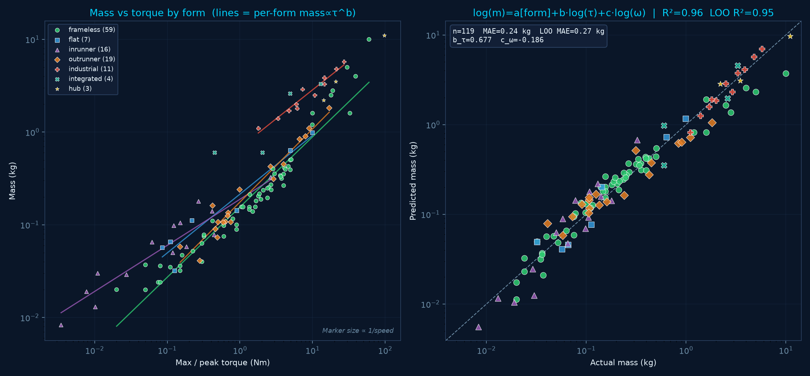
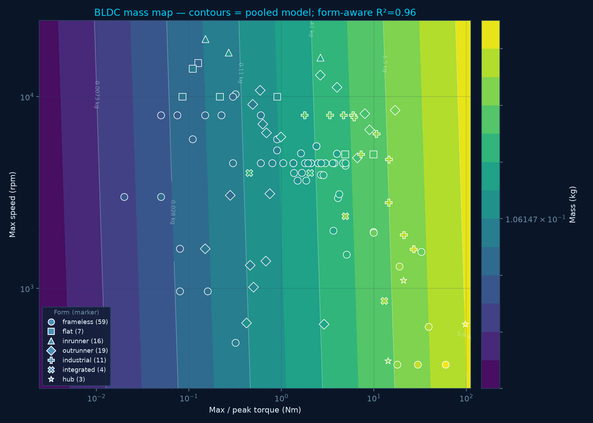
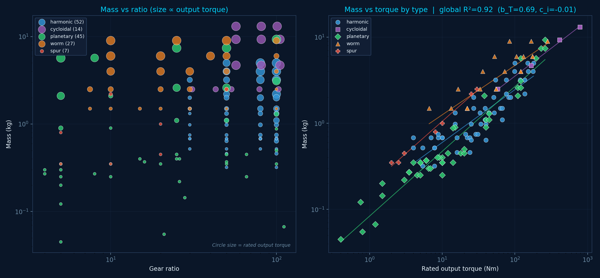

# Actuators: joint modules, motors and gearboxes

Component datasets and mass models behind the arm sizing model in the [README](README.md). The same fits feed the humanoid analyses in [HUMANOIDS.md](HUMANOIDS.md). Joint modules come first, including how a complete module's mass compares with its bare gearbox + motor. Bare BLDC motors and gearboxes follow.

## Joint modules

The same repo also tracks **complete robot joints** (motor + gear + encoder, usually with a driver) in `data/robot_joint_data.csv`.



### Dataset

**142 modules** from 19 manufacturers, in six classes: harmonic (67), QDD (31), series-elastic (21), planetary (9), hobby-servo (8), cycloidal (6).

`Cost_USD` is a one-off street or quote price. `Cost_Flag` says how it was filled:

- **listed** — shop, Alibaba sample, or official list price
- **user** — Maxon HDT ~$5k and HEJ $7.5k quotes
- **estimate** — analog / brand-ladder fill for quote-only catalog parts (Harmonic Drive FHA/SHA, Leaderdrive, Nidec, HIWIN, leftover eRob, etc.)

Empty spec cells stay empty when a datasheet does not publish them. Notes cite the source.

### Price estimator

The joint app fits a two-stage log-price model on **listed + user rows only** (97 training points). Estimates are shown in the CSV but are not used to train.

- Stage 1: `log(price) = a[type] + b·log(torque) + c·log(1/accuracy)`
- Stage 2: weakly regularized residual on speed, size, mass, encoder, brake, driver
- Accuracy is a class default (harmonic 0.25 arcmin, QDD 12, etc.) unless you override it
- Current fit: in-sample R²(log) **0.77**, leave-one-out R² **0.69**, LOO MAE **~$950**
- Torque elasticity is shallow (~0.19): class (QDD vs harmonic vs SEA) moves price more than Nm
- Example: 20 Nm QDD, 90 mm, 0.6 kg → **~$316**. A 50 Nm harmonic in a similar envelope → **~$2.1k**

```bash
pixi run joint-app
pixi run joint-analyze
pixi run python analyze_joint_prices.py --torque 20 --speed 120 --od 90 --mass 0.6 --type qdd
```

`joint-app` is a Streamlit estimator with the same dark theme as the arm app. `joint-analyze` reprints the fit and regenerates `robot_joint_price_fit.png`. Do not insert a bare `--` between the pixi task and argparse flags.

### Module mass vs. bare gearbox + motor



Each module is a single-DOF joint. `analyze_joint_module_overhead.py` takes each module's own spec (rated torque, peak torque, ratio, rated speed), sizes a bare gearbox + motor with the fits from `arm_mass_model.py`, and divides the module's published mass by that prediction. No integration factor is applied. It is the same per-module ratio whose median the arm model uses as its integration factor, and the script prints a check that the medians match (they do, to three decimals).

- **Gearbox** is sized on rated torque and ratio. **Motor** is sized on peak torque ÷ (ratio · η) and rated rpm × ratio. Missing rated or peak torque is filled with the 2.5× rule, a missing ratio with the type default, and a missing speed with 60 rpm. These are the same fills the integration-factor calibration uses, and they're flagged in the CSV.
- **harmonic / cycloidal / planetary / qdd** use the type-matched gearbox fit and the frameless motor fit (qdd uses the planetary gearbox fit). **series-elastic / hobby-servo** use the pooled `all` fits. The pooled result is also in the CSV for every module.
- 136 of 142 modules have a published mass. Per-module numbers are in `robot_joint_module_overhead.csv`.

| Type | n | Median module ÷ theory | Lighter than theory |
|---|---|---|---|
| hobby-servo | 8 | 0.64× | 100 % |
| qdd | 31 | 0.65× | 94 % |
| planetary | 9 | 0.69× | 100 % |
| cycloidal | 6 | 0.96× | 50 % |
| harmonic | 61 | 1.07× | 41 % |
| series-elastic | 21 | 1.37× | 19 % |

**The module is not reliably heavier than its components.** 57 % of modules come in *lighter* than the bare gearbox + motor the fits predict (77 % among the 53 modules whose inputs are all published and inside the fitted ranges). The spread is large (0.4×–3.3×) and depends mostly on type:

- **qdd and planetary** modules are about 0.65× theory with little scatter, and all of them sit inside the fitted ranges. The fits were trained on standalone catalog parts, which likely carry their own housing, bearings and flanges that an integrated module shares.
- **harmonic** is bimodal. Compact integrated servos (eRob I, TD, HPJM-PRO) are only 0.5–0.6× theory. Harmonic Drive's SHA / FHA actuators with their large housings are about 2.2×, which is where the "structure" overhead is most visible.
- **series-elastic, hobby-servo and cycloidal** are all more than 25 % outside the fitted torque / ratio / speed ranges (series-elastic ratios are 254–1742:1 against fitted gearboxes of at most ~110:1), so treat those medians as indicative only.

So `Module_kg − Theory_kg` understates the real structure + electronics mass wherever the fits over-predict.

```bash
pixi run joint-overhead
```

## BLDC motors

Bare brushless motors (not geared joint modules) live in `data/bldc_motor_data.csv`.





### Dataset

**120 motors** (119 used in the fit: listed mass + peak torque + max speed). Sources span CubeMars (frameless RI/RO + GL gimbal), Maxon (EC / ECX SPEED / ECX FLAT), Faulhaber (micro through 32 mm), Kollmorgen (AKM2G LV), Teknic ClearPath, ODrive, T-Motor, plus **AliExpress/Alibaba OEM** (MOSRAC/TSL U-series, SteadyWin WK/GB, Maintex LW, Honpine FM1, XRobotek XMD031, Flipsky, HXC, scooter/QS hubs). Dense below **5 Nm** (~94 rows), especially **&lt;1 Nm** (~54 rows).

| Peak torque | Count |
|---|---|
| &lt;0.05 Nm | 6 |
| 0.05–0.2 | 18 |
| 0.2–0.5 | 15 |
| 0.5–1 | 15 |
| 1–2 | 12 |
| 2–5 | 28 |
| 5–10 | 9 |
| 10+ | 17 |

| Form | Count | Role in catalog |
|---|---|---|
| **frameless** | 59 | Robot joint kits (CubeMars, MOSRAC, Honpine, …) |
| **outrunner** | 19 | Prop / gimbal / hub-adjacent BLDC |
| **inrunner** | 16 | Precision micros (Maxon ECX SPEED, Faulhaber) |
| **industrial** | 11 | Packaged servos (Kollmorgen AKM2G) |
| **flat** | 7 | Maxon EC / ECX FLAT pancakes |
| **integrated** | 4 | ClearPath-style drive-in-motor |
| **hub** | 3 | Wheel / hub motors |

Core fields:

- **Max_Torque_Nm** — peak / stall / short-term max (primary torque for the mass model)
- **Max_Speed_rpm** — no-load or catalog max speed
- **Weight_kg** — published motor mass (`Weight_Flag=listed`, or `estimate` when only a class analog exists)
- **Form** — categorical form used as the type dummy (like gearbox `Type`)
- Optional: continuous torque, OD/length, Kv, pole pairs, voltage, street price

Notes cite the catalog / shop page. Empty cells mean the source did not publish that number.

### Mass models

Same pattern as the gearbox type model: a shared torque/speed slope with a **form-specific intercept**, plus optional per-form `mass∝τ^b` lines on the plot.

#### 1. Form-aware global (primary estimator)

```
log(mass) = a[form] + b · log(τ_max) + c · log(ω_max)
```

Current fit (n=119 listed-mass rows):

| | Value |
|---|---|
| **b** (torque) | **+0.677** |
| **c** (speed) | **−0.186** |
| R²(log) | **0.956** |
| LOO R² | **0.947** |
| MAE | **0.241 kg** |
| LOO MAE | **0.275 kg** |

Effective intercepts `a[form]` (log-mass units; lower = lighter for the same τ, ω):

| Form | a[form] | n |
|---|---|---|
| frameless | −0.348 | 59 |
| outrunner | −0.182 | 19 |
| flat | +0.181 | 7 |
| hub | +0.365 | 3 |
| inrunner | +0.744 | 16 |
| integrated | +1.036 | 4 |
| industrial | +1.079 | 11 |

So for a given torque/speed, **frameless / outrunner are lightest**; **industrial / integrated are heaviest** (~4× heavier than frameless at the same point). Example at **τ = 2 Nm, ω = 4000 rpm**:

| Form | Estimated mass |
|---|---|
| frameless | **0.24 kg** |
| outrunner | 0.29 kg |
| flat | 0.41 kg |
| inrunner | 0.72 kg |
| industrial | **1.01 kg** |

#### 2. Pooled (no form) — contour backdrop

```
log(mass) = a + b · log(τ_max) + c · log(ω_max)
```

Used only for the torque–speed **contour map** (one surface for all forms). Weaker than the form-aware model: R²(log) **0.868**, LOO R² **0.861**, MAE **0.429 kg**. Contours are nearly vertical → mass is mostly a torque story once form is ignored.

#### 3. Per-form torque lines (plot overlays)

For each form with **≥5** rows, a simple `log(m) = a + b·log(τ)` is fit and drawn on the left panel of `robot_motor_mass_fit.png` (colored line matching the dots). Speed-only slopes are printed for diagnostics but are weak for most forms.

| Form | mass ∝ τ^b | R² | MAE | n |
|---|---|---|---|---|
| outrunner | **τ^0.79** | 0.95 | 0.04 kg | 19 |
| frameless | **τ^0.76** | 0.93 | 0.29 kg | 59 |
| flat | **τ^0.63** | 0.93 | 0.04 kg | 7 |
| industrial | **τ^0.62** | 0.95 | 0.27 kg | 11 |
| inrunner | **τ^0.50** | 0.88 | 0.02 kg | 16 |

`integrated` and `hub` are too sparse (&lt;5 rows) for a per-form line; they still get a global `a[form]` intercept in the primary estimator.

### Plots

- **`robot_motor_mass_fit.png`** — left: mass vs peak torque by form (marker size ∝ 1/speed), with per-form `mass∝τ^b` lines; right: form-aware predicted vs actual (identity line, R²≈0.96).
- **`robot_motor_mass_contour.png`** — pooled mass contours on the τ–ω plane; dots are measured motors colored by mass, shaped by form.

```bash
pixi run motor-analyze
pixi run python analyze_motor_mass.py --torque 2.0 --speed 4000 --form frameless
```

## Gearboxes / reducers

Bare reducers (not full joint modules) live in `data/gearbox_data.csv`.



### Dataset

**~146 reducers** spanning ratios **~4:1–100:1** (a few up to 111:1), sized so **rated input torque** overlaps the motor set (~0.01–40 Nm input; ~94 rows in the 0.5–30 Nm motor-matched band).

| Type | Sources | Notes |
|---|---|---|
| **harmonic** | Harmonic Drive CSF-2UH / LW; AliExpress HBK/SHF | Mass fixed per frame across 30/50/80/100 |
| **cycloidal** | Nabtesco RV-E | Heavy, high torque; mass per frame |
| **planetary** | Neugart PLE; Maxon GPX; AliExpress FLE42/GP42 | 1-stage ≈ QDD (5–10); 2–3 stage for 25–100 |
| **worm** | NMRV 030–075 | Mass fixed per size; ratios 7.5–100 |
| **spur** | Small industrial / Boston-class analogs | Thin coverage |

Core fields: `Ratio`, `Stages`, `Rated_Output_Torque_Nm`, `Weight_kg`, `OD_mm`, `Length_mm`, derived `Rated_Input_Torque_Nm ≈ T_out / ratio`. Price filled where street listings were clear.

### Mass / size model

Important empirical result: **within a frame, mass barely changes with ratio**. Ratio alone is a weak predictor; **output torque capacity (frame size) and type** dominate:

```
log(mass) = a[type] + b · log(T_out) + c · log(ratio)
```

Typical fit on this set: **b ≈ 0.70**, **c ≈ −0.02**, R²(log) **~0.92**. Per-type mass∝T^b: harmonic ~0.61, planetary ~0.76, worm ~0.57, cycloidal ~0.65. Mass∝ratio alone has R² ≈ 0 for harmonic/worm.

```bash
pixi run gearbox-analyze
pixi run python analyze_gearbox_mass.py --ratio 50 --torque-out 40 --type harmonic
```

Writes `robot_gearbox_mass_fit.png` (mass vs ratio + mass vs torque by type) and `robot_gearbox_od_fit.png` (housing OD vs torque).
