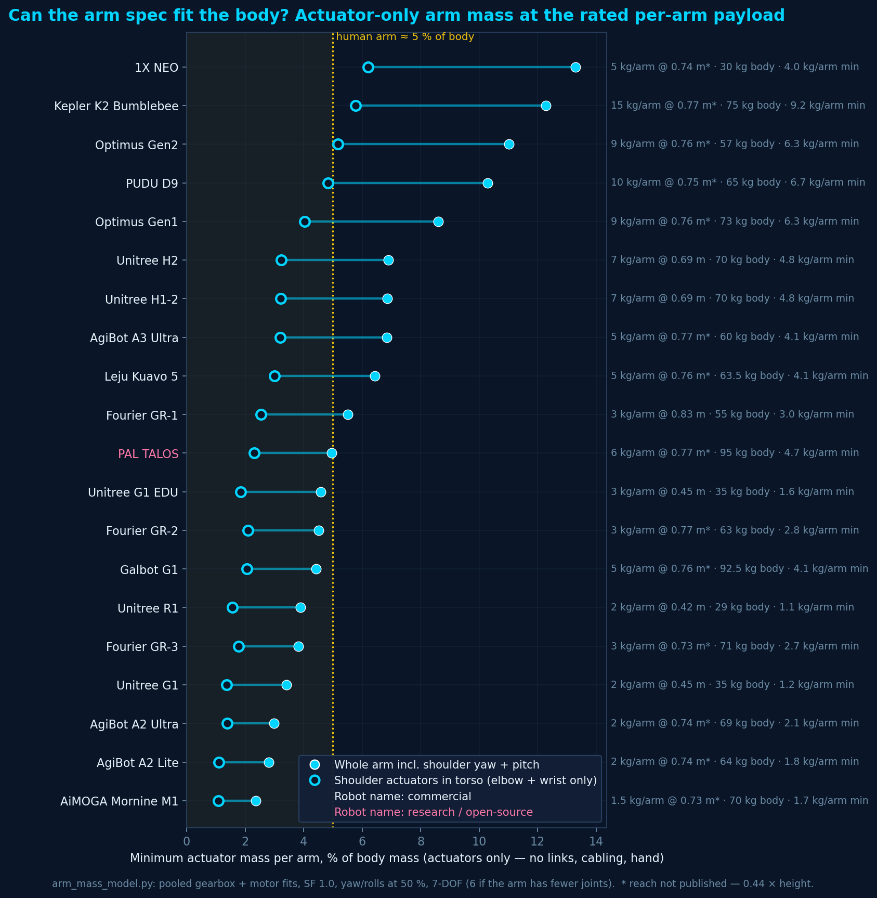
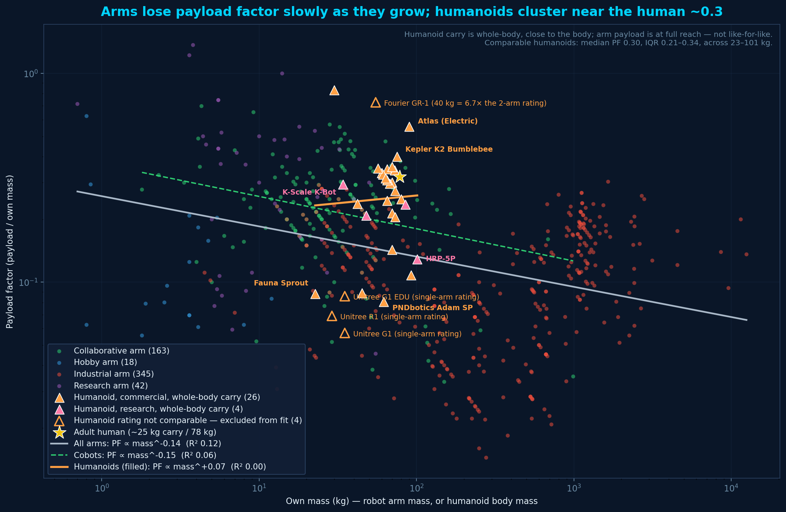
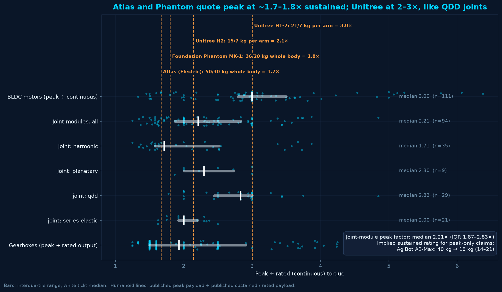
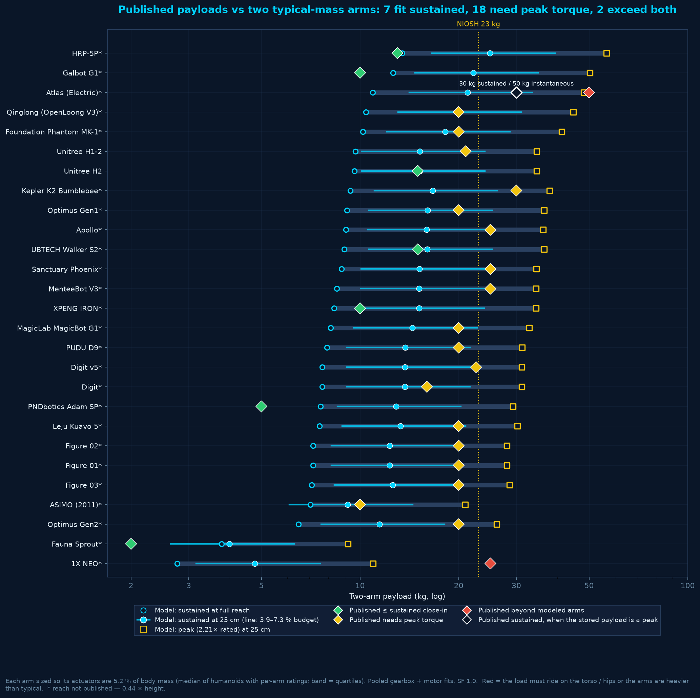
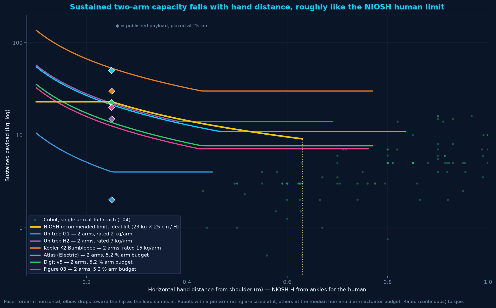
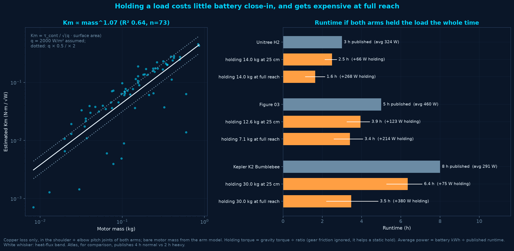
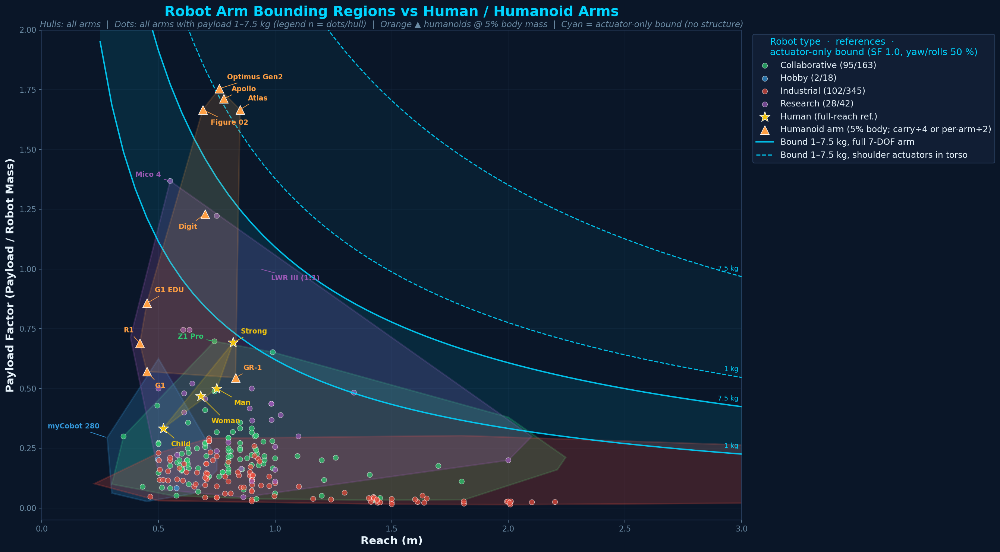

# Humanoid robots

Whole-body humanoid specs, and analyses that check published humanoid payloads against the robot-arm, motor and gearbox data. The serial-arm dataset and arm sizing model are in the [README](README.md). The motor, gearbox and joint-module fits used here are in [ACTUATORS.md](ACTUATORS.md).

```bash
pixi run humanoid-plot          # humanoid_payload_efficiency.png
pixi run humanoid-analysis      # actuator share + payload-factor scaling
pixi run humanoid-credibility   # peak vs rated, plausibility, capacity vs reach, holding power
pixi run plot                   # also writes robot_arm_human_comparison_hulls.png
```

## Humanoid robots (whole-body catalog)

Whole-robot humanoid hardware lives in **`data/humanoid_robot_data.csv`** (73 platforms). This is separate from `data/human_humanoid_arm_data.csv`, which only stores the **per-arm** points used in the reach–PF humanoid comparison plot.

| Field | Meaning |
|---|---|
| `Height_m` / `Weight_kg` | Standing height and body mass (with battery when published) |
| `Total_DOF` / `Arm_DOF` / `Leg_DOF` / `Hand_DOF` | Joint counts; leave blank when unpublished |
| `Payload_kg` | Published whole-robot / bimanual carry (or Atlas instant capacity) |
| `Arm_Payload_kg` / `Arm_Reach_m` | Per-arm rated load and arm length/span when known |
| `Speed_mps` / `Battery_h` | Walk speed and runtime (walking when both given) |
| `Cost_KUSD` | USD ÷ 1000 |
| `Cost_Flag` | `listed` (shop/OEM price) · `target` (maker scale goal) · `estimate` (press/FX midpoint) · `quote` · `raas` |
| `Status` | `shipping` · `production` · `pilot` · `preorder` · `internal` · `prototype` |
| `Notes` | Source URL / caveats |

Empty cells mean unpublished — do not invent numbers. Many enterprise platforms (Atlas, Digit, Figure, Apollo) have solid hardware specs but **no public list price**.

### Humanoid plots

One hardware figure (arm reach–vs–PF analog): **height vs carry/mass**, circle size = body mass. Cyan arrows connect successive generations of the same platform when both gens have height + mass + carry (e.g. Optimus Gen1→Gen2, Digit→Digit v5, Figure 02→03).

```bash
pixi run humanoid-plot
```

Output: `humanoid_payload_efficiency.png`. Hardware only — no status coloring.

### Humanoid arm specs vs the arm model

```bash
pixi run humanoid-analysis
```

`analyze_humanoid_scaling.py` uses the arm data and `arm_mass_model.py` to sanity-check humanoid specs.



**`humanoid_arm_actuator_share.png`** checks whether each humanoid's per-arm payload rating is plausible. For each one, it sizes a single arm at the rated payload and reach (actuators only: pooled gearbox + motor fits, SF 1.0, yaw/rolls at 50 %). It then plots the minimum actuator mass as a % of body mass, with and without the shoulder actuators (on a humanoid those sit in the torso).

A human arm is ~5 % of body mass. **1X NEO (5 kg/arm on a 30 kg body), Kepler K2 (15 kg/arm), Optimus (9 kg/arm) and PUDU D9 (10 kg/arm) need ~5–6 % of body mass per arm in elbow + wrist actuators alone.** That leaves essentially nothing for links, cabling or hands under the "arm ≈ 5 % body" rule. Light-arm robots (AgiBot A2, AiMOGA M1, Unitree G1) need only 1–2 %. Reach falls back to 0.44 × height when it isn't published.



**`humanoid_vs_arm_payload_scaling.png`** plots payload factor against own mass (log-log) for 566 arms and 31 humanoids:

- **Arms:** payload factor falls slowly with size (PF ∝ mass^−0.14, weak).
- **Comparable humanoids:** **median 0.30 (IQR 0.21–0.35)** across 23–101 kg, right at the adult-human ~0.32, with no trend (PF ∝ mass^−0.03, R² 0.00). The two smallest whole-body points pull in opposite directions: **Fauna Sprout** (22.7 kg, 2 kg carry, PF 0.09) and **1X NEO** (30 kg, 25 kg whole-body carry, PF 0.83). Fauna's 2 kg comes from aggregator sites, not the company page, and isn't labelled whole-robot vs per-arm. If it is per-arm, it belongs with the excluded single-arm ratings below.
- **Excluded from the fit (hollow):** Unitree G1 / G1 EDU / R1, whose "payload" is a single-arm rating, and Fourier GR-1, whose 40 kg is 6.7× its two-arm rating. With them in, the humanoid fit shows a spurious PF ∝ mass^+1.2.
- **Not like-for-like:** humanoid carry is whole-body and close to the body, while arm payload is at full reach.

Most whole-body carry ratings equal 2 × the per-arm rating (K2, D9, H2, Optimus). So humanoid carry is arm-limited, not leg-limited.

### What does a humanoid "payload" mean?

`analyze_humanoid_payload_credibility.py` (`pixi run humanoid-credibility`) uses the motor, gearbox and joint-module data to read published payloads as sustained vs peak and close-in vs full reach. Capacity uses a bent-arm pose: forearm horizontal, elbow dropping toward the hip as the load comes in. Shoulder and elbow pitch limit the load. Wrist pitch is left out, because a two-handed carry clamps the load near the wrist axis.



**`humanoid_peak_vs_rated.png`:** peak ÷ rated torque is about 3.0× for BLDC motors, 2.2× for joint modules (1.7× harmonic, 2.8× QDD) and 1.9× for gearboxes. Atlas (50 / 30 kg) and Foundation Phantom (36 / 20 kg) quote peak at 1.7–1.8× sustained. Unitree H2 (2.1×) and H1-2 (3.0×) sit at QDD-joint ratios. Using the 2.2× joint median, AgiBot A2-Max's 40 kg claim implies about 18 kg sustained.



**`humanoid_payload_plausibility.png`:** each humanoid gets two arms sized so their actuators are a typical humanoid share of body mass. That share is 5.2 %, with a 3.9–7.3 % band: the quartiles of the per-arm-rated robots in the actuator-share figure. The figure then compares the published payload with what those arms hold sustained at full reach, sustained at 25 cm, and at peak torque at 25 cm. Seven robots fit sustained, 18 only fit at peak torque, and two exceed both. Those two are 1X NEO, whose 25 kg is whole-body carry on a 30 kg robot, and Atlas's 50 kg instantaneous rating (its 30 kg sustained also needs peak torque). Most "20–25 kg" ratings (Figure, Optimus, Apollo, Digit v5) look like close-in peak lifts, not sustained holds.



**`humanoid_capacity_vs_reach.png`:** sustained two-arm capacity vs horizontal hand distance, next to the NIOSH recommended weight limit (23 kg × 25 cm / H, other multipliers 1) and single-arm cobots. Robots with a per-arm rating are sized at that rating; the rest use the median arm budget. H2 and Atlas track the NIOSH curve closely, and Digit v5 and Figure 03 sit below it. Kepler K2's 15 kg/arm rating puts it well above.



**`humanoid_holding_power.png`** is the most speculative of the four, since the data has no winding resistance. Motor constant Km is estimated as continuous torque ÷ √(q × surface area), with an assumed q = 2000 W/m² (band ×0.5 / ×2), and fit against motor mass. Runtime is battery kWh ÷ (published average power + copper loss holding the load in both arms' shoulder and elbow pitch). Holding close-in costs 65–125 W. At full reach it costs 210–380 W, which roughly halves runtime and is in line with Atlas's published 4 h normal vs 2 h heavy. Only H2, Figure 03 and Kepler K2 publish kWh, runtime and payload together.

#### About the NIOSH reference

NIOSH (the US National Institute for Occupational Safety and Health) publishes the Revised Lifting Equation (1991), the standard ergonomics check for manual lifting:

```
RWL = 23 kg × HM × VM × DM × AM × FM × CM
```

The 23 kg load constant is the recommended limit under ideal conditions, set so most workers can lift it safely. Each multiplier is 1.0 when ideal and shrinks as conditions worsen. `HM = 25 cm / H` covers the horizontal hand distance in front of the ankles, and it drops to zero beyond 63 cm. The others cover lift height (VM), vertical travel (DM), twisting (AM), frequency (FM) and grip (CM). This is guidance, not an OSHA legal limit.

The figures above use only `HM` and set the rest to 1, so the NIOSH curve is a best case: an infrequent, two-handed, untwisted lift with a good grip. Robot distances are measured from the shoulder, not the ankles, which is close for an upright robot. NIOSH is a risk-based limit for a typical worker, not human maximum strength, so "above NIOSH" means above the recommended human working load.

## Humanoid arms vs the robot-arm design space

`generate_summary_plot.py` (`pixi run plot`) draws this one alongside the arm summary figures in the [README](README.md).

### Human & humanoid comparison (`robot_arm_human_comparison_hulls.png`)



Compares **serial robot-arm design space** to **human** and **humanoid** arm references on the same axes (reach vs payload factor):

- **Type convex hulls** from every arm with mass, payload, and reach (~500 rows)
- **Dots** for every arm with payload in the humanoid range (**1–7.5 kg**), priced or not. They're coloured by robot type, all the same size, with no price or repeatability weighting (201 of ~500 arms).
- **Human** references (yellow ★) and **humanoid** arm estimates (orange ▲)
- Landmark labels: **LWR III (1:1)**, **Mico 4** (research), collaborative max, **myCobot 280**
- **Cyan band**: the actuator-only payload-ratio bound from `arm_mass_model.py` (no structure). It uses the pooled `all` gearbox + motor fits, SF 1.0, and yaw/roll joints at 50 %, for a 7-DOF arm. The band spans the humanoid payload range (**1–7.5 kg** per arm at full reach, after the derates below).
  - **Solid** = the full arm, including both shoulder actuators.
  - **Dashed** = shoulder yaw + pitch actuators removed. On a humanoid those sit in the torso and aren't part of the ~5 % arm mass, so this is the fairer comparison.

  Optimus, Figure 02, Apollo and Atlas (5–7.5 kg) sit *above* the solid band but well inside the dashed band. Their arm-mass estimate only works if the shoulder actuators are counted as torso mass.

Human/humanoid reference numbers live in `data/human_humanoid_arm_data.csv`. The hull figure applies the humanoid assumptions below at plot time (it does not rewrite that CSV).

### Assumptions (humanoids)

All humanoids are treated as one family (orange) with a shared mass rule:

1. **Arm mass ≈ 5% of whole-robot body mass**  
   Used for G1 / G1 EDU / R1 / GR-1 / Optimus Gen2 / Figure 02 / Apollo / Digit / Atlas.

2. **Published “carry” ratings are whole-robot, close-to-body**  
   For Optimus, Figure, Apollo, Digit, and Atlas we convert to a **single-arm, full-reach** estimate as:
   - ÷2 for two arms sharing the load  
   - ÷2 again because carry is near the torso, not at full reach  
   - → **per-arm full-reach payload ≈ carry / 4**

   | Robot | Published carry | Per-arm full-reach (÷4) |
   |---|---|---|
   | Optimus Gen2 | 20 kg | 5.0 kg |
   | Figure 02 | 20 kg | 5.0 kg |
   | Apollo | 25 kg | 6.25 kg |
   | Digit | 16 kg | 4.0 kg |
   | Atlas | 30 kg sustained | 7.5 kg |

3. **Official one-arm ratings** (Unitree G1 / G1 EDU / R1, Fourier GR-1) are already per-arm; we only apply a **÷2 full-reach derate** (not the bimanual ÷2).

4. **Reach** for the five “leading” platforms is a **pixel estimate** from full-body photos (shoulder → hand / fingertip scaled by published height). Atlas uses a human-proportioned estimate (~0.44 × stature) when a clean arms-down photo was unavailable. BD’s published **2.3 m** figure is treated as whole-body workspace reach, not shoulder→hand arm length.

5. **Humans** use separate anthropometric estimates (not the 5% humanoid rule): continuous full-reach hold payloads and shoulder→fingertip reaches for Child / Woman / Man (**0.75 m**) / Strong.

6. These humanoid points are **illustrative**, not datasheet arm specs. Payload factor above ~1 is rare for production serial arms (DLR **LWR III** is the classic research 1:1; Kinova arms are classified here as **research** for separation from cobot fleets — **Mico 4** / **Jaco 4** exceed PF 1 mainly on mid-range continuous ratings with light structures).
