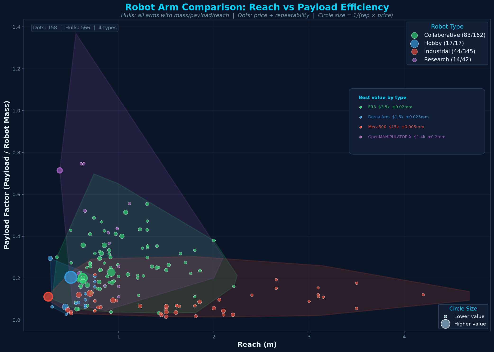
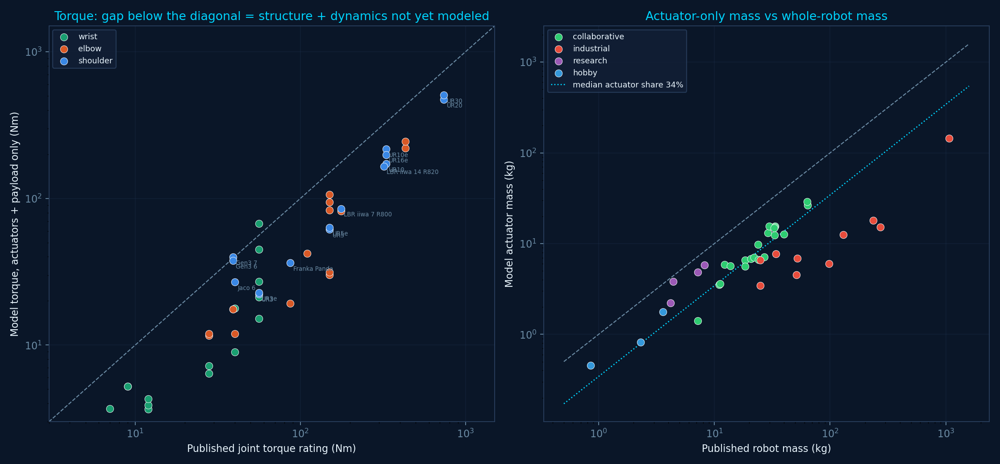
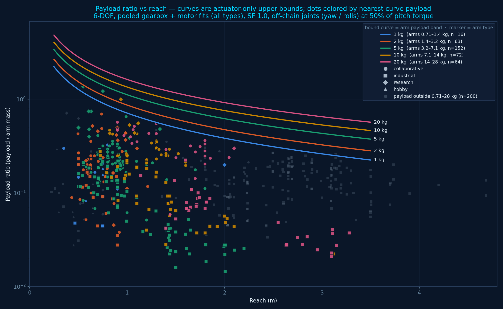

# robot_arm_data

Research data about robot manipulators, scraped from public online sources.



## Dataset Overview

This dataset contains specifications for hundreds of robot arms across 4 categories (`collaborative`, `industrial`, `research`, `hobby`). Regenerate the three summary figures with `pixi run plot`.

### Summary plot (`robot_arm_summary.png`)

- **Reach vs Payload Factor** — Payload factor is `payload / robot mass`. Higher values indicate more efficient designs that can lift more relative to their own weight.
- **Color by Type** — Collaborative (green), industrial (red), hobby (blue), research (purple).
- **Convex Hulls** — Shaded regions use **every** arm in that type with mass, payload, and reach (~500 rows). Price is **not** required for hull membership.
- **Dots** — Placed only when **price and repeatability** are both known (~160 rows). Circle size is the value metric `1 / (repeatability × price)` (larger = better value). Legend counts are `priced-dots / hull-members`.

### High payload-efficiency box (`robot_arm_high_pf.png`)

Zoom on arms with **PF > 0.4** and **reach < 2 m**:

- Includes **every** arm with mass/payload/reach in that box — **price and repeatability are not required** (so unpriced research peaks like **Mico 4** / **Jaco 4** / **LWR III** appear).
- Hulls and dots use that same high-PF set; the purple research region extends up to the highest-PF vertex in the box.
- Yellow dashed vertical marks **adult male arm reach (0.75 m)** from the human reference used in the humanoid comparison figure.

### Human & humanoid comparison (`robot_arm_human_comparison_hulls.png`)

The third summary figure compares arm design space with human and humanoid arms. It and its assumptions are documented in [HUMANOIDS.md](HUMANOIDS.md#humanoid-arms-vs-the-robot-arm-design-space).

### Assumptions (robot hulls)

- Payload factor = `Payload_kg / Weight_kg` using the CSV values as published (no carry÷4 derate on industrial/cobot rows).
- Hull vertices are the convex hull of each `Type` in reach–PF space after dropping rows missing reach, mass, or payload.
- On the summary figure, dots require price + repeatability (circle size = value). The high-PF zoom does **not**. The humanoid-comparison figure shows every arm in the humanoid payload range, all the same size.

```bash
pixi run plot
```

Outputs: `robot_arm_summary.png`, `robot_arm_high_pf.png`, `robot_arm_human_comparison_hulls.png`.

## Data Sources

All data is collected from corporate websites, company catalogs, resellers, or random blog posts. I tried to make notes of strange sources in the additional notes column when necessary. Occasionally some of the estimates were in euros, so the conversion to dollars may be out of date.

Updated info is welcome via pull request.

## Analyses

This README covers the serial-arm dataset and the arm actuator sizing model. Two companion articles cover the rest:

- **[HUMANOIDS.md](HUMANOIDS.md):** the whole-body humanoid catalog, humanoid payload and scaling analyses, and the arm-vs-human/humanoid comparison.
- **[ACTUATORS.md](ACTUATORS.md):** joint modules (price model, module vs bare gearbox + motor), BLDC motors and gearboxes, with the mass fits the arm model uses.

## Running the Analysis App

This repo includes an interactive Streamlit app for exploring robot arm data, comparing payload factors, and estimating costs.

### Prerequisites

Install [pixi](https://pixi.sh) if you haven't already:

```bash
curl -fsSL https://pixi.sh/install.sh | bash
```

### Running the App

From the project directory, run:

```bash
pixi run app
```

This will start a local Streamlit server and open the app in your browser at `http://localhost:8501`.

### Features

- **Interactive filtering** by robot type (Articulated, Collaborative, Delta, SCARA, etc.)
- **Parameter sliders** for DOF, reach, payload, and repeatability
- **Auto-estimation** of robot mass and cost using regression models trained on the dataset
- **Payload factor visualization** comparing your configuration against real robots
- **Cost analysis** with price-per-DOF calculations

### Regenerating plots

```bash
pixi run plot
```

This runs `generate_summary_plot.py` and writes the three arm figures described above (summary, high-PF zoom with Man-reach line, human/humanoid hull comparison).

## Arm actuator mass model

Estimates **motor + gearbox mass for every joint of a 6- or 7-DOF arm** from just **reach** and **payload**. Actuators are sized one at a time, starting at the wrist and working back to the shoulder. Structure mass comes next. The loop already has a placeholder for it.



### Link-length heuristic

`data/arm_geometry_data.csv` holds published DH / dimension-drawing link lengths for **38 arms** (UR, Franka, iiwa, Kinova, xArm, Doosan, Techman, AUBO, ABB, KUKA, FANUC, Yaskawa, Stäubli, Trossen, …). Each arm is reduced to the lever chain seen by the pitch joints when stretched out horizontally: `shoulder offset → upper arm → forearm → wrist pitch→flange`. Base height (floor → shoulder pitch) is kept for drawing only. It never acts as a lever arm.

Median fractions of reach (chain length ≈ published reach, median ratio 1.04):

| Basis | n | upper | forearm | wrist | offset | base height |
|---|---|---|---|---|---|---|
| all | 38 | 0.44 | 0.42 | 0.14 | 0.00 | 0.27 |
| collaborative | 21 | 0.45 | 0.42 | 0.14 | 0.00 | 0.18 |
| industrial | 10 | 0.41 | 0.44 | 0.08 | 0.07 | 0.40 |
| research/hobby | 7 | 0.46 | 0.35 | 0.19 | 0.00 | 0.32 |

The fractions are roughly scale-free across 0.3–2.7 m reach (`robot_arm_geometry_fit.png`). The `Confidence` column flags rows from approximate drawings.

### Joint clusters and sizing chain

| Cluster | Joints (6-DOF) | 7-DOF adds | Sized by |
|---|---|---|---|
| wrist | forearm roll, wrist pitch, wrist roll | — | wrist pitch |
| elbow | elbow pitch | upper-arm roll | elbow pitch |
| shoulder | shoulder yaw, shoulder pitch | — | shoulder pitch |

Each cluster's sizing (pitch) joint carries the payload plus every actuator distal to it in the chain, with the arm horizontal. The other joints in the cluster don't carry that gravity moment: shoulder yaw, upper-arm roll, forearm roll and wrist roll. Each gets its own, smaller actuator, sized to a fraction of the sizing joint's torque. The default is **50 %**, set per joint with the GUI sliders or with `--secondary`. Because mass ∝ torque^~0.7, a 50 % joint weighs about 60 % of its pitch joint's actuator. The lighter roll actuators also reduce the load on every pitch joint closer to the base.

```
T = SF · g · [ m_payload · x_payload + Σ_distal m_i · x_i ]      (SF defaults to 1.0 = pure static)
τ_motor = T / (ratio · η[gearbox]),   ω_motor = ω_joint · ratio
m_actuator = k[gearbox] · ( m_gearbox(type, T, ratio) + m_motor(form, τ_motor, ω_motor) )
```

The wrist pitch carries its own cluster's wrist roll, so the sizing is a fixed-point iteration. The loop re-runs wrist → elbow → shoulder until no mass changes by more than 10 µg (typically 4–5 passes). `k` is an **integration factor** calibrated on `robot_joint_data.csv` (see [ACTUATORS.md](ACTUATORS.md#module-mass-vs-bare-gearbox--motor)): complete module mass ÷ predicted bare gearbox + motor. It comes out to 0.98 for harmonic, 0.96 for cycloidal, 0.65 for planetary/QDD, and 1.0 where there is no module data (worm/spur).

**Validation:** with each arm's real geometry, the actuator-only torques fall below the published joint ratings. That gap is the link structure and dynamics this model doesn't include yet. Model actuator mass is a median **~31 %** of whole-cobot mass (27 % across all arms). Industrial arms sit much lower because their castings are heavy.

### Payload-ratio upper bound



`payload_ratio_sweep()` sizes the arm for payloads of **1, 2, 5, 10 and 20 kg** at reaches from **0.25 to 3.5 m**. Each point is plotted as `payload / actuator mass`. The model has no structure mass, so each curve is the **best-case payload ratio** for that payload. A real arm should sit below its payload's curve.

The curves use the **`all`** gearbox and motor option, which is a pooled fit over every gearbox type and every motor form with no type term. It represents an average actuator design:

- **Gearbox:** `log m = −2.07 + 0.75·log T_out − 0.06·log ratio`, with ratio 50 (the data median) and η 0.77 (weighted by how many of each type are in the data)
- **Motor:** `log m = −1.94 + 0.75·log τ + 0.05·log ω`
- **Integration factor:** 0.69, calibrated across all joint modules

6-DOF, SF 1.0 (pure static), off-chain joints at 50 %:

| Reach | 1 kg | 2 kg | 5 kg | 10 kg | 20 kg |
|---|---|---|---|---|---|
| 0.25 m | 2.23 | 2.67 | 3.39 | 4.06 | 4.85 |
| 0.5 m | 1.28 | 1.54 | 1.97 | 2.36 | 2.83 |
| 1 m | 0.71 | 0.87 | 1.12 | 1.35 | 1.63 |
| 1.5 m | 0.50 | 0.61 | 0.80 | 0.97 | 1.17 |
| 2 m | 0.38 | 0.47 | 0.62 | 0.76 | 0.92 |
| 2.5 m | 0.31 | 0.39 | 0.51 | 0.62 | 0.76 |
| 3 m | 0.26 | 0.33 | 0.43 | 0.53 | 0.65 |
| 3.5 m | 0.22 | 0.28 | 0.38 | 0.46 | 0.57 |

Each curve has its own colour. Published arms are coloured by the curve whose payload is nearest theirs, using log-midpoint bands (0.71–1.4, 1.4–3.2, 3.2–7.1, 7.1–14 and 14–28 kg), so each dot can be compared against its own line. Arms outside 0.71–28 kg are gray, and marker shape shows arm type. In the GUI, the **Highlight payload band** buttons (all / 1 / 2 / 5 / 10 / 20 kg) bring one curve and its arms to the front, fade the rest, and count how many arms in that group fall below or above the line.

The ratio rises with payload because actuator mass grows like torque^0.7–0.75, which is sub-linear. For a single design, pick a specific gearbox and motor (`--gearbox harmonic --motor frameless`, or the GUI buttons). The bound curves stay on `all`. For comparison, at 0.85 m / 5 kg, `all` + `all` gives 3.9 kg of actuators, harmonic + frameless 5.0 kg, and planetary + frameless 2.9 kg.

```bash
pixi run arm-mass                                    # 0.85 m / 5 kg example, validation + payload-ratio plots
pixi run python arm_mass_model.py --reach 1.3 --payload 10 --dof 7 --gearbox planetary --motor outrunner
pixi run geometry-analyze                            # refit fractions, robot_arm_geometry_fit.png
pixi run arm-mass-app                                # interactive GUI
```

The GUI (`arm_mass_app.py`) has reach/payload sliders and selector buttons for DOF, gearbox type, motor type and geometry basis. Gearbox and motor both default to `all`. It also has expanders for link-fraction overrides, safety factor, tool offset, per-cluster ratio / speed and a kg/m structure placeholder. It draws the arm with every actuator's mass called out, plus the motor/gearbox breakdown and the iteration history. The main chart plots **payload ratio against reach** for every published arm, with the 1–20 kg upper-bound curves drawn on top. The curves always use the `all` gearbox + motor. DOF, geometry, SF, speeds and structure follow the sidebar, and the gearbox/motor buttons move only the ★ for your specific design. It warns when a torque, ratio or speed falls outside the fitted motor/gearbox data.
